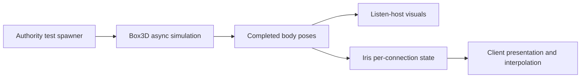

<div align="center">
  <h1>Box Physics Example</h1>
  
  <p><em>Header image coming soon</em></p>
  <p>An Unreal Engine example project for exploring Box3D physics, asynchronous simulation, and multiplayer replication.</p>
  <p>
    <a href="#getting-started"></a>
    <a href="#getting-started"></a>
    <a href="https://github.com/ArtemIyX/Box3DUnreal"></a>
    <a href="#multiplayer-example"></a>
  </p>
</div>

## Purpose

This project is a place to try and verify [Box3D Unreal](https://github.com/ArtemIyX/Box3DUnreal), a plugin that integrates Box3D physics with Unreal Engine. It includes example maps and game-side code for async bodies, authority-driven replication, and a Blueprint-triggered explosion. The plugin lives in a separate repository and is included here as a Git submodule.

## Getting started

You need Unreal Engine 5.7, Git, and a C++ build environment supported by your Unreal installation. On Windows, install Visual Studio with the **Game development with C++** workload.

Clone the project and its plugin submodule:

```bash
git clone --recurse-submodules https://github.com/ArtemIyX/BoxPhysicsExample.git
```

If you already cloned without submodules, run this from the project directory:

```bash
git submodule update --init --recursive
```

Open `BoxPhysicsExample.uproject`, rebuild project modules if prompted, and open a map from `Content/Maps` in the editor. The project enables the async backend and configures Iris in its default settings. See the [plugin README](Plugins/Box3DUnreal/README.md) for plugin setup and features.

## Example maps

The project includes these maps in the Content Browser under **Content → Maps**:

| Map | Focus |
| --- | --- |
| `MAP_AsyncPhysics` | Async physics |
| `MAP_AsyncReplication` | Async body replication. |
| `MAP_ExplosionReplication` | The replication and explosion example. |

## Multiplayer example

The test spawner creates actorless dynamic bodies on the authority. The server simulates them, and Iris delivers their poses to clients for local presentation. On a listen server, the host also sees local visuals; a dedicated server does not need them. Presentation actors do not use Unreal actor or movement replication for these bodies.



To set up your own test level, place a **Box3D Replication Test Spawner** above a **Box3D Async Presentation Actor** configured as a static floor with a mesh that has simple collision. The spawner creates a director if one is not already present, then starts 32 bodies after three seconds by default. Its body count, delay, spawn area, height, mesh, and scale are editable in the level.

Run with a listen server and a client, or with a dedicated server and client, and watch the cubes fall and settle. For Iris setup, the body registration lifecycle, and current replication limits, see the [Box3D replication guide](Plugins/Box3DUnreal/Source/Box3DReplication/README.md).

### Try an explosion

Call **Explode Box 3D Bodies** on the test spawner from an authority-side Blueprint, providing a world-space location, radius in centimeters, and impulse strength in kg·cm/s. Bodies are pushed outward with linear falloff. The node reports accepted and rejected async commands; it requires body-state publication, which is enabled by default. A client-originated request needs a game-owned server RPC.

## Repository layout

| Path | Contents |
| --- | --- |
| [Source/BoxPhysicsExample](Source/BoxPhysicsExample) | Example game module, test spawner, and verification code. |
| [Content/Maps](Content/Maps) | Example Unreal maps. |
| [Config](Config) | Project, async backend, and Iris configuration. |
| [Plugins/Box3DUnreal](Plugins/Box3DUnreal) | Box3D Unreal plugin submodule, pinned to the commit used by this project. |

For the plugin source, issues, and documentation, visit the [Box3D Unreal repository](https://github.com/ArtemIyX/Box3DUnreal).

## Licnse

Project is licensed under [MIT](LICENSE)
